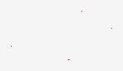
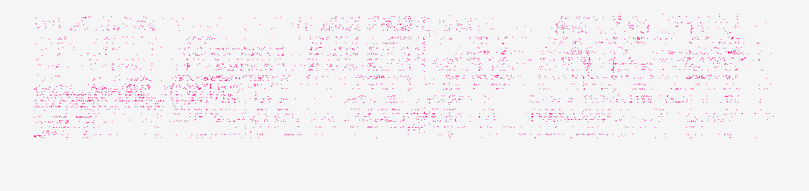

# Phase 4C.1 visual sign-off investigation

Historical investigation at checkpoint `5cb647c7`. The subsequent user-authorized reference review and verification are recorded in [Phase 4C.1 final sign-off](PROJECTS_LISTING_VISUAL_SIGNOFF.md); the findings and original evidence below are preserved unchanged.

**NO-GO for Phase 4C.2.** The investigation isolates a capture-state discrepancy, with no Projects UI regression found. The strict approved-reference gate remains **79/81**, so this checkpoint does not grant visual acceptance. Two candidate reference updates are provided for review; none has been applied. All 818 prior comparisons and the seven-width Privacy pilot pass on their accepted reruns.

24 November 2026, Europe/Skopje. Worktree `D:/eke-web/.worktrees/frontend-tailwind-phase1`, branch `codex/frontend-tailwind-phase1`. Migration checkpoint `5aeba7c0`; unchanged-source checkpoint `53f718e7`. Earlier checkpoints are preserved.

## Findings for each reference

| Reference | Difference from both cold original and migrated captures | Immediate cause |
|---|---|---|
| `769-ongoing` | Five pixels, maximum channel delta **1**, bounds `(613,6973)`–`(724,7027)` in a 769×7267 PNG | Alternate rasterization of the shared PartnerSection SVG artwork immediately above the Footer. No text, geometry, filter or card difference. |
| `1099-empty` | 4,279 pixels, maximum channel delta **6**, in a 1099×6541 PNG: **4,155** hero-photo pixels, **90** output-artwork pixels, **34** PartnerSection-artwork pixels | Alternate rasterization of scaled bitmap/SVG artwork. The same assets and layout produce different pixels depending on capture surface history. |

The [three-way measurements](projects-baseline/signoff/three-way.json) compare approved reference → unchanged original → Tailwind migration, including exact PNG hashes, pixel bounds and channel deltas. Both implementations have the **same cold-capture hashes** for these two failures. All recorded computed styles and behavior match the approved records. There are no masks, perceptual thresholds or permitted differing pixels.

The source-independent classification is established; the exact Edge/ANGLE/Skia internal cache or sampling bug is **not** established. Do not describe the references as an outdated design, or claim a particular driver defect has been proved. They contain a raster state that the cold capture does not reliably reproduce. This is a test/reference reproducibility problem, not evidence of a Tailwind regression.

## Controlled capture experiments

The [summary](projects-baseline/signoff/summary.json) and compressed [original](projects-baseline/signoff/original/probe.json.gz) / [migrated](projects-baseline/signoff/tailwind/probe.json.gz) probe records preserve **28 captures per implementation**, plus two read-only staging screenshots. They record image rectangles/intrinsic dimensions, loaded font faces, viewport/DPR, media queries, fixture hash, asset hashes, timing and browser/renderer identity.

- Repeated shots, a further three-second wait, a cold reload and scrolling through the full page retain the failing cold hashes for both implementations.
- Returning from width+1 to the requested width can produce the approved PNG exactly, without any change to final layout, assets, fonts or content. In the migrated probe, both final `resize-reset` shots equal the approved PNG hashes byte-for-byte. The original probe has identical final geometry but different raster results. This directly demonstrates capture-history dependence; it does **not** establish a reliable fix.
- A bounded test-only retry experiment painted an intermediate full-page surface, restored viewport/scroll/DPR, waited for fonts/images and animation frames, and retained the exact comparison. Its complete 81-case run still failed the same two references. [Rejected experiment results](projects-baseline/signoff/rejected-repaint/comparison.json) and [manifest](projects-baseline/signoff/rejected-repaint/manifest.json.gz) are retained. The helper and all changes to the strict capture harness were removed. No ineffective workaround is shipped.
- The initial 1099px reference set itself renders the unchanged hero photo differently between Empty and Ongoing: **4,155** differing pixels in the same photo area. Empty and Past match there. Original and migrated cold Empty instead match Ongoing. Fixture changes below the hero do not explain a hero image/content change.

The first new full unchanged-source control also encountered a transient `1440-past-selected` PNG difference with zero style/behavior differences; its complete [raw comparison](projects-baseline/signoff/raw-control/comparison.json), [manifest](projects-baseline/signoff/raw-control/manifest.json.gz), and [source verification](projects-baseline/signoff/raw-control/source-verification.json) are preserved independently of the final control run. This is not silently converted into a pass.

## Environment, responsive behavior and approved baseline

All three reference/control/migration manifests assert Edge **158.0.4370.33**, Intel UHD/D3D11 driver **27.20.100.9664**, **GaneshGL**, and `--force_low_power_gpu`. The probes independently confirm DPR **1**, visual scale **1**, 1000px viewport height, exact requested inner/client width and no horizontal overflow. Locale is en-GB, timezone Europe/Skopje, reduced motion, light scheme. Primary local font faces are loaded; every observed image is complete with nonzero intrinsic dimensions. Fonts and fixtures are identical between original and migration. The contract-shaped fixture SHA-256 is `5c2d7a3098561f4fcf6c8c39130c71c03f275a00f86ab762dcea3bf77be36db2`.

Responsive probes cover **768, 769, 770, 1098, 1099, 1100 and 1101px**. Original and migrated layout/image records match for all 28 paired probes, including after viewport reset. At 769 and 1099, `(max-width:1100px)` is active and `(max-width:700px)` is inactive: filters remain above the single Projects column. There is no breakpoint at 768/769. At 1101, the existing desktop sidebar layout activates. Hero/photo geometry changes smoothly within each breakpoint range. The complete Projects matrix also checks 699/700/701 and the interaction/sticky states.

The approved design authority documented in [source reconciliation](TAILWIND_SOURCE_RECONCILIATION.md) is public staging, not an identified Figma file. Read-only staging checks confirm the unchanged release marker `dd76db4434f103cf8b7b93c20ccaea7190abd2e2-45292330641-1`. The two viewport captures were inspected; hero typography, wrapping, photograph, crop and stripe match the documented staging composition. All **90 observed assets**, including fonts and prefetched assets, match staging: binary files exactly; SVGs after CRLF/LF normalization. [Asset review](projects-baseline/signoff/tailwind/staging-assets.json) records both raw hashes and normalized equality. Staging CMS content differs from synthetic Empty/Ongoing fixtures, so whole-page staging PNG equality is not claimed. No independent design file was supplied or invented.

## Minimum proposed reference update — review only

Only these two capture entries and their corresponding PNGs would need updating to adopt the reproducible cold state. Their approved computed-style/behavior records and all other **79** references stay unchanged.

| Capture | Existing approved SHA-256 | Proposed cold original/migrated SHA-256 |
|---|---|---|
| `769-ongoing` | `6240ec2f5e75fbf4b9b177c6d6681e8aa0fa17e8321524bf7d195c46537e9082` | `27881d1a2e69460bac0e4e77afb22f898e8a5874fd1dee2fa1454b6f3eb7a98e` |
| `1099-empty` | `11e1cbaf5ec68100707e47c63c95da33fd0fd2a9d1ed2d130c3bbb1b055e5029` | `3916b8e11a92db6d2755b30d3212b9ac6d8ebcdcfa00c5023b4e01f95517d119` |

Candidate full PNGs are local review artifacts in `docs/projects-baseline/signoff/review-candidates/`; the [proposal](projects-baseline/signoff/reference-update-proposal.json) records their hashes and scope. This proposal is **not applied** and does not assert all-green sign-off against a changed reference. Reviewers should compare the following committed evidence (left to right: approved / original / migrated; magenta marks every differing pixel):

Output/PartnerSection crops and exact diffs are in the same evidence directory. Full approved PNGs remain untouched. Adopting a cold-state reference would still require reviewer acceptance and a new full strict run; this investigation does not authorize future reference regeneration or tolerate raster noise.

## Verification and stopping point

| Check | Result |
|---|---|
| Projects vs approved initial references | **79/81; FAIL**, exactly the two named captures; zero computed-style/behavior/request/live-data/media differences |
| Final unchanged-source control vs approved | **79/81; FAIL**, same two references; original source hashes verified |
| Migration vs final unchanged-source control | **81/81 exact**, diagnostic parity only |
| News components / production / listing | **84/84 + 63/63 + 42/42 exact** |
| Privacy approved / breakpoint pilot | **3/3 + 7/7 exact** |
| Shared UI routes | **324/324 exact** on unchanged full rerun |
| Shared gallery / native controls | **96/96 + 88/88 exact** |
| Contact software / NVIDIA | **59/59 + 59/59 exact** |
| Integration | **18/18 passed** |
| Production builds, lint, TypeScript | **Passed** |
| SEO | **4/4 passed**, exported metadata/robots/sitemap verified across **13** staging-mode pages |

The prior suites total **818** exact comparisons, plus the seven-width pilot. The first Shared UI run failed one About pixel by at most two channel levels; its [pixel finding](projects-baseline/signoff/first-regression/about-pixels.json), [comparison](projects-baseline/signoff/first-regression/shared-routes.json) and [full first-run results](projects-baseline/signoff/first-regression/regression.json) remain available. The unchanged 324-case rerun passed; no threshold/reference/style change was used to obtain that result. The sandbox initially prevented Edge startup/build writes; those execution failures were superseded by complete runs outside the sandbox, not counted as visual passes.

Only diagnostic tools, evidence and this report are retained. The default strict Projects harness, renderer and application/shared styles are unchanged. `projects-control.cjs --signoff-probe` adds an opt-in diagnostic after the original-source capture, within its existing source restoration `finally` block. Historical generated outputs are restored after the new evidence is copied into `projects-baseline/signoff/`.

Reproduce using `node docs/projects-regression.cjs`; run the optional original-source probe with `node docs/projects-control.cjs --signoff-probe`, then the migrated diagnostic with `node docs/projects-signoff-probe.cjs tailwind`. `node docs/projects-signoff-probe.cjs tailwind --staging-assets-only` reviews remote bytes without UI writes. `node docs/projects-signoff-evidence.cjs` and `node docs/projects-signoff-summary.cjs` rebuild local review artifacts, never approved references. The strict Projects command remains nonzero.

**Stop at Phase 4C.1.** No Project Details migration, PR, merge, deployment, CMS mutation or baseline approval was performed. Phase 4C.2 remains **NO-GO** until the reference decision is reviewed and the strict gate is green.
